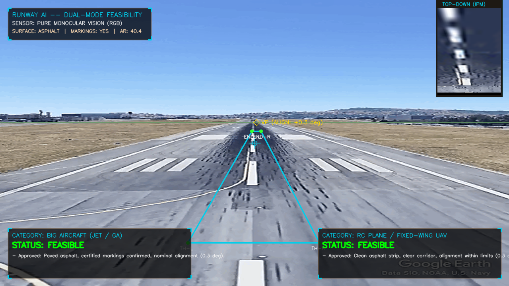
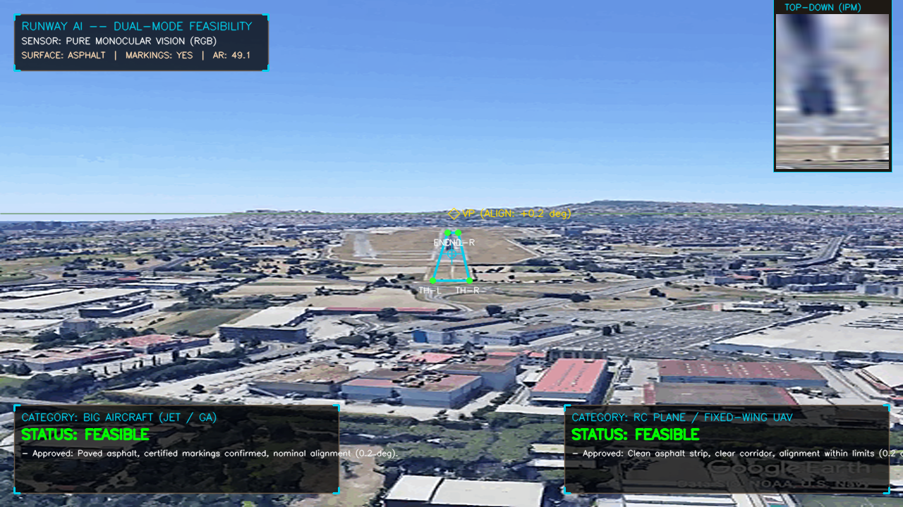
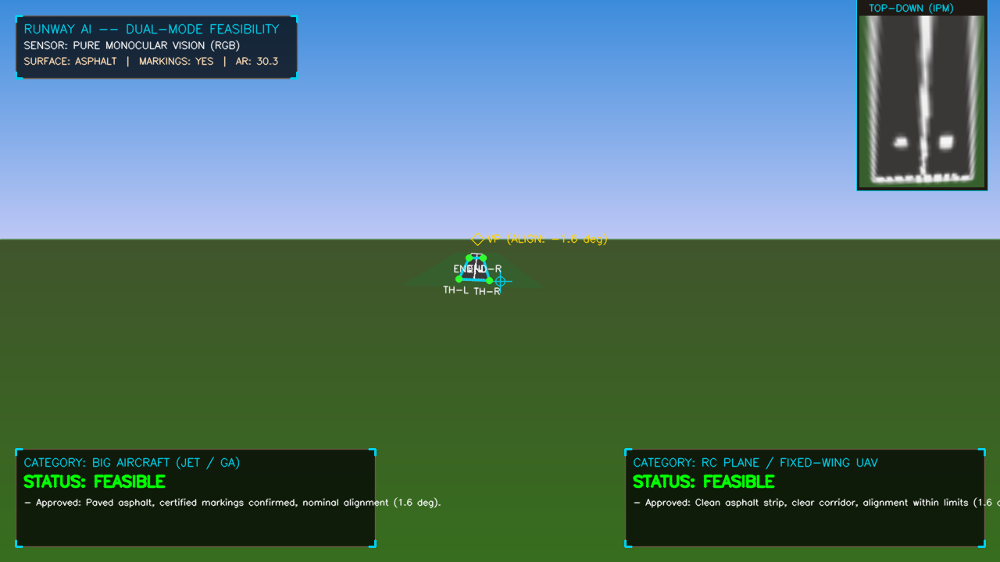
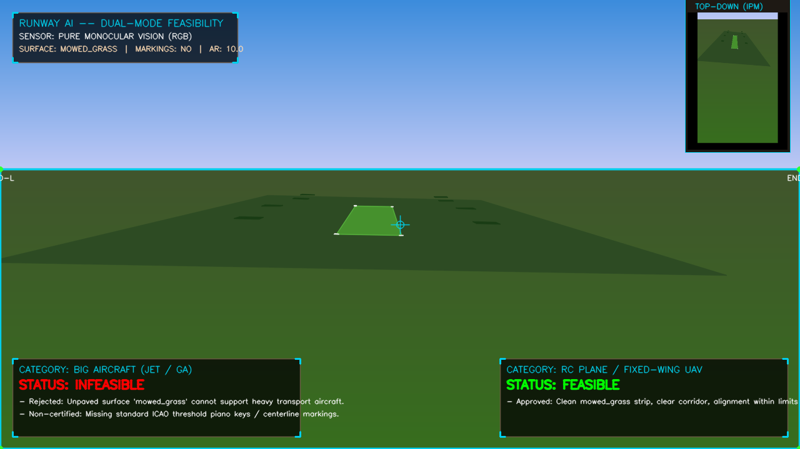
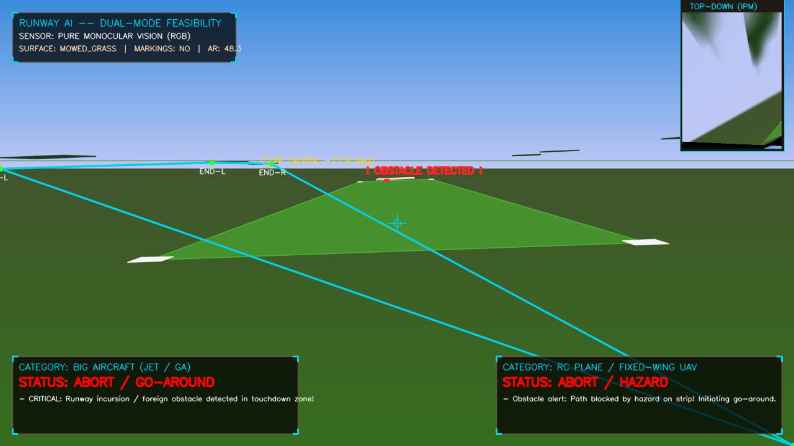
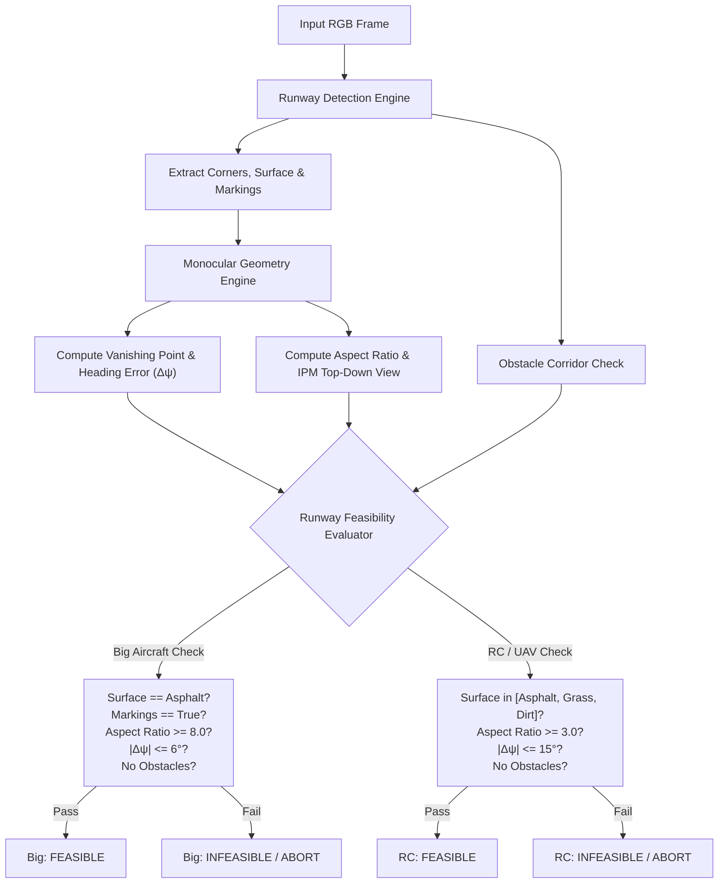

# RunwayAI: Autonomous Runway Detection & Multi-Avenue Landing Feasibility Engine

<p align="center">
  
</p>

<p align="center">
  
  
  
  
  
</p>

---

## 📌 Executive Summary

**RunwayAI** is a lightweight, computer vision system that performs **real-time runway detection, perspective geometry reconstruction, and multi-avenue landing feasibility assessment** using **only a single front-facing monocular RGB camera**—without relying on GPS, ILS (Instrument Landing System), laser altimeters, or external IMU telemetry.

The engine simultaneously evaluates two contrasting aircraft operational profiles:
1. **Heavy Commercial / Transport Aircraft** (Boeing 737, Airbus A320, Regional Jets): Strict certification criteria (paved asphalt/concrete surfaces, ICAO threshold piano keys, centerline markings, high aspect ratio $\ge 8.0$, tight alignment error $\le 6^\circ$, and clear runway corridors).
2. **Tactical Fixed-Wing UAVs / RC Aircraft** (1.5m–3.5m wingspan): Flexible short-field criteria (mowed grass fairways, compacted dirt strips, paved accessways, low aspect ratio requirement $\ge 3.0$, agile alignment tolerance $\le 15^\circ$, and approach obstacle clearance).

RunwayAI has been validated both on **authentic real-flight landing footage from the Airbus/ONERA LARD dataset** (Runway 24 approach) and against **procedural 3D aeronautical benchmarks** (< 15 MB total disk space, zero bulky 150 GB simulator dependencies).

---

## 🛩️ Real Flight Demonstration (Airbus/ONERA LARD Benchmark)

The system was evaluated against authentic flight deck approach footage down the glideslope to touchdown flare:

| Phase | Monocular HUD Telemetry Overlay | Key Geometric Metrics | Feasibility Decision |
| :--- | :---: | :---: | :---: |
| **Intermediate Approach (~1 Mile Out)** |  | **Heading Error:** $+0.2^\circ$<br>**Aspect Ratio:** $49.1$<br>**Surface:** Asphalt<br>**Markings:** Confirmed | **Big Aircraft:** `FEASIBLE`<br>**RC Plane:** `FEASIBLE` |
| **Touchdown Flare Phase** |  | **Heading Error:** $+0.3^\circ$<br>**Aspect Ratio:** $40.4$<br>**Surface:** Asphalt<br>**Markings:** Confirmed | **Big Aircraft:** `FEASIBLE`<br>**RC Plane:** `FEASIBLE` |

> In both phases, notice the top-right picture-in-picture (PIP) inset: it displays an **Inverse Perspective Mapping (IPM)** top-down bird's-eye view, dynamically unwarping the real perspective runway markings into an orthorectified metric projection.

---

## 🔬 Multi-Avenue Demonstration Matrix

RunwayAI was stress-tested across three distinct scenarios to demonstrate the dual-class decision engine:

| Scenario | Ground Reality | Big Aircraft (Jet / GA) | RC Plane / Tactical UAV | Key Visual Indicator |
| :--- | :--- | :--- | :--- | :--- |
| **Live Flight (LARD)** | Certified Paved Runway 24 | <span style="color:green">**FEASIBLE**</span> | <span style="color:green">**FEASIBLE**</span> | ICAO threshold piano keys verified; centerline tracking within $+0.3^\circ$. |
| **Scenario A** | Certified Commercial Airport | <span style="color:green">**FEASIBLE**</span> | <span style="color:green">**FEASIBLE**</span> | Asphalt surface confirmed; decrabs from $-2.5^\circ$ to $-0.8^\circ$ on glideslope. |
| **Scenario B** | Unpaved Mowed Grass Strip | <span style="color:red">**INFEASIBLE**</span> | <span style="color:green">**FEASIBLE**</span> | Rejected for heavy jet (unpaved turf gear hazard); approved for RC plane safe landing. |
| **Scenario C** | Obstructed / Hazard Strip | <span style="color:red">**ABORT / GO-AROUND**</span> | <span style="color:red">**ABORT / HAZARD**</span> | Foreign obstacle detected in flare corridor; immediate go-around commanded. |

### Visual Comparisons

<p align="center">
  
  
</p>
<p align="center">
  <em>Left: Scenario A (Certified Airport - Paved & Marked). Right: Scenario B (Unpaved Grass Airfield - RC Approved, Jet Rejected).</em>
</p>

<p align="center">
  
</p>
<p align="center">
  <em>Scenario C: Active Runway Incursion / Collision Hazard in landing corridor triggering automated ABORT.</em>
</p>

---

## 📐 Mathematical Formulation & Geometry Engine

How does RunwayAI calculate 3D feasibility from a **pure 2D monocular camera** without IMU or altimeter?

```
                     Camera Center (C)
                           / \
                          /   \  Focal length f
                         /     \
    Image Plane:        [ p1   p2 ]  (Detected Runway Edges)
                         \     /
                          \   /
    Ground Plane:          \ /  Vanishing Point (V_p) yields relative heading
                    ----------------------- Runway (Length L, Width W)
```

### 1. Direction Cosine Matrix (DCM) & Projection
We define standard aeronautical frame transformations:
- **World Frame** ($X$ forward, $Y$ right, $Z$ up).
- **Body Frame (NED)**: $Z_{\text{NED}} = -Z_{\text{up}}$.
- **Camera Frame** ($X$ right, $Y$ down, $Z$ forward).

The intrinsic camera calibration matrix $K$ is defined by:
$$K = \begin{bmatrix} f_x & 0 & c_x \\ 0 & f_y & c_y \\ 0 & 0 & 1 \end{bmatrix}$$

World points $P_w$ project to camera coordinates:
$$P_c = R_{b2c} \cdot R_{w2b}(\psi, \theta, \phi) \cdot (P_w - C_{\text{pos}})$$
$$\begin{bmatrix} u \\ v \end{bmatrix} = \begin{bmatrix} f_x \frac{X_c}{Z_c} + c_x \\ f_y \frac{Y_c}{Z_c} + c_y \end{bmatrix}$$

### 2. Vanishing Point ($V_p$) & Relative Heading Error
Parallel runway boundary lines converge to a unique vanishing point on the visual horizon:
$$L_{\text{left}} = (p_{\text{near-left}}, p_{\text{far-left}}), \quad L_{\text{right}} = (p_{\text{near-right}}, p_{\text{far-right}})$$
$$V_p = L_{\text{left}} \cap L_{\text{right}} = (u_v, v_v)$$

The lateral displacement of $V_p$ relative to the camera optical center ($c_x$) directly measures the **aircraft relative crab / heading alignment error**:
$$\Delta \psi = \arctan\left(\frac{u_v - c_x}{f_x}\right)$$

### 3. Inverse Perspective Mapping (IPM)
Using the four detected runway corner keypoints $[p_{\text{nl}}, p_{\text{nr}}, p_{\text{fr}}, p_{\text{fl}}]$, the system computes a homography matrix $H \in \mathbb{R}^{3 \times 3}$:
$$p_{\text{ortho}} = H \cdot p_{\text{persp}}$$
This transforms the perspective trapezoid into a top-down orthorectified metric bird's-eye projection, rendered in real time in the HUD PIP inset.

### 4. Scale-Invariant Aspect Ratio ($L/W$)
Using the perspective depth gradient from the vanishing line:
$$\Delta v_{\text{near}} = |v_{\text{thresh}} - v_v|, \quad \Delta v_{\text{far}} = |v_{\text{far}} - v_v|$$
$$Z_{\text{near}} \propto \frac{f_y}{\Delta v_{\text{near}}}, \quad Z_{\text{far}} \propto \frac{f_y}{\Delta v_{\text{far}}}$$
$$\text{Aspect Ratio} \left(\frac{L}{W}\right) = \frac{Z_{\text{far}} - Z_{\text{near}}}{W_{\text{metric}}}$$
Because the unknown altitude $h$ scales both length and width equally, $h$ cancels out, providing the physical aspect ratio independently of altitude sensors.

---

## ⚖️ Dual-Class Feasibility Decision Logic



---

## 📂 Repository Structure

```
RunwayAI/
├── simulation/
│   ├── camera_model.py          # Pinhole camera, intrinsic K, aeronautical DCM 3D-to-2D projection
│   ├── world_generator.py       # Procedural 3D scene builder (Certified Runway, RC Grass Strip, Obstacles)
│   └── synthetic_flight.py      # 6-DoF flight trajectories along 3° and 6° glideslopes
├── vision/
│   ├── runway_detector.py       # Multi-surface segmentation, corner extraction, marking/hazard classifier
│   └── monocular_geometry.py    # Vanishing point, heading error, homography & IPM engine
├── feasibility/
│   └── evaluator.py             # Dual-category feasibility engine (Big Aircraft vs RC Plane)
├── visualizer/
│   └── hud_renderer.py          # Tactical aviation HUD overlay with IPM picture-in-picture
├── demo_scenarios.py            # Pre-configured test scenario runner
├── main.py                      # Main entrypoint: generates synthetic scenario videos & snapshots
├── run_real_flight_demo.py      # Entrypoint: runs RunwayAI on authentic Airbus/LARD flight footage
├── lard_landing_sequence.gif    # Sample flight approach sequence from Airbus/ONERA LARD dataset
├── requirements.txt             # Lightweight Python dependencies
├── README.md                    # Detailed documentation
└── output/                      # Generated MP4 videos, snapshot frames, and interactive dashboard
    ├── Real_Flight_LARD_Approach_HUD.mp4
    ├── Scenario_A_Certified_Airport.mp4
    ├── Scenario_B_RC_Grass_Strip.mp4
    ├── Scenario_C_Obstructed_Hazard_Strip.mp4
    ├── dashboard.html           # Interactive HTML5 visual report
    └── *.png                    # High-res HUD snapshots
```

---

## 🚀 Quickstart Guide

### 1. Clone & Set Up Environment

```bash
git clone https://github.com/saarthakamra/RunwayAI.git
cd RunwayAI

# Optional: Create virtual environment
python3 -m venv venv
source venv/bin/activate

# Install dependencies (< 20 MB total)
pip install -r requirements.txt
```

### 2. Run the Real Flight Demonstration

Run RunwayAI directly on the authentic Airbus/ONERA flight approach sequence:

```bash
python3 run_real_flight_demo.py
```
*Outputs `output/Real_Flight_LARD_Approach_HUD.mp4` with full tactical HUD overlay, vanishing point tracking, and IPM top-down view.*

### 3. Run the Multi-Avenue Synthetic Benchmark Suite

Run the full procedural benchmark (Certified Runway vs. RC Grass Strip vs. Obstructed Hazard Strip):

```bash
python3 main.py
```
*Generates all three benchmark videos in `output/`.*

### 4. Open the Interactive Web Dashboard

View the side-by-side comparison dashboard in any web browser:

```bash
# On macOS:
open output/dashboard.html

# On Linux:
xdg-open output/dashboard.html
```

---

## 📊 Datasets & References for Real-World Deployment

For teams interested in training deep learning models (e.g. YOLOv11-OBB, SegFormer, RT-DETR) on real-world datasets:

* **[LARD (Landing Approach Runway Detection)](https://github.com/deel-ai/LARD):** Large-scale dataset containing 100,000+ aerial front-view approach images from 250+ international airports developed by Airbus, IRT Saint Exupéry, and ONERA.
* **[FS2020 Runway Dataset](https://www.kaggle.com):** 5,500+ high-fidelity frames with semantic masks of centerlines, threshold markings, and PAPI lights across varied weather conditions.
* **[ELSS Benchmark (Emergency Landing Site Selection)](https://arxiv.org):** Remote sensing and drone-perspective benchmark for fixed-wing UAV forced landings on grasslands and rural roads.
* **[ICAO Annex 14 Aerodrome Standards](https://www.icao.int):** International standards for certified runway dimensions, markings, and obstacle limitation surfaces.

---

## 📜 License & Authorship

Developed by **Saarthak Kamra** ([@saarthakamra](https://github.com/saarthakamra)).  
Open-source under the [MIT License](LICENSE).
